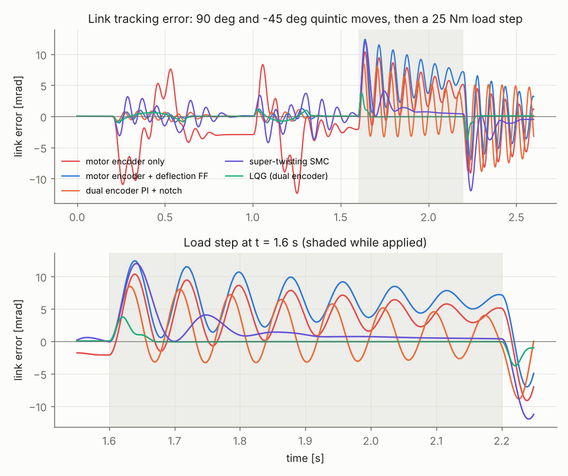
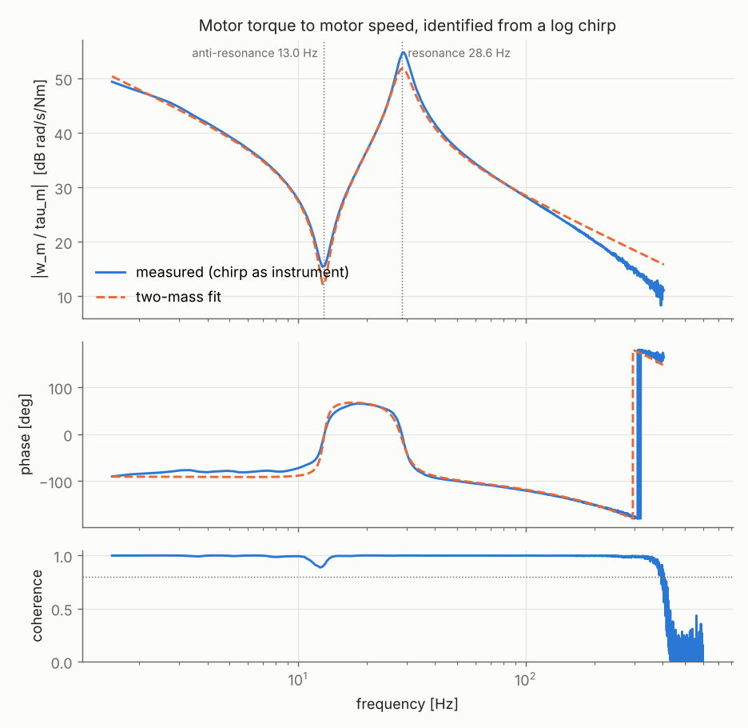
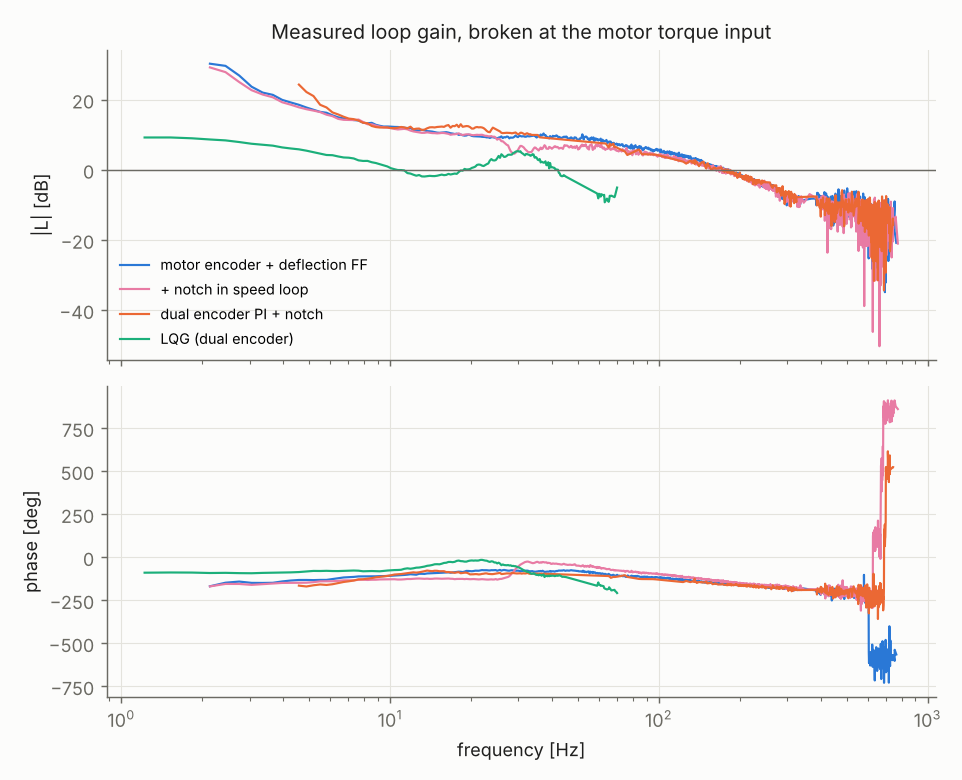
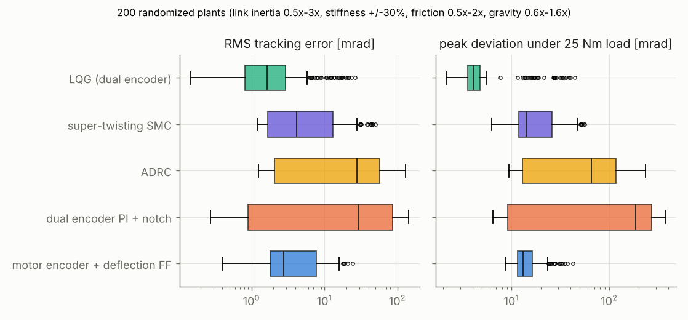
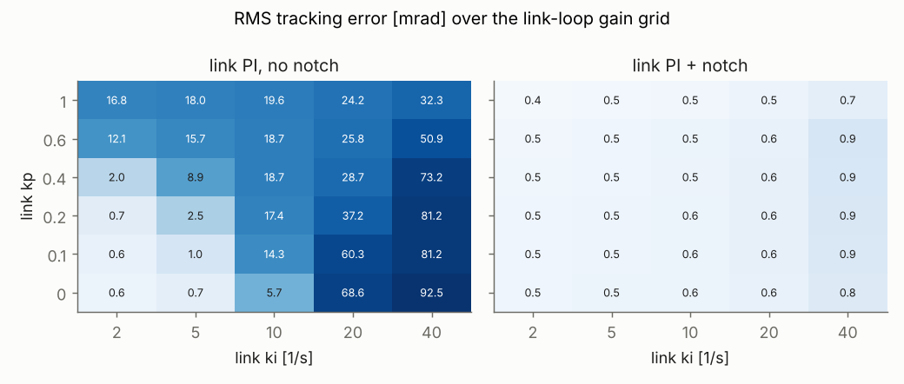
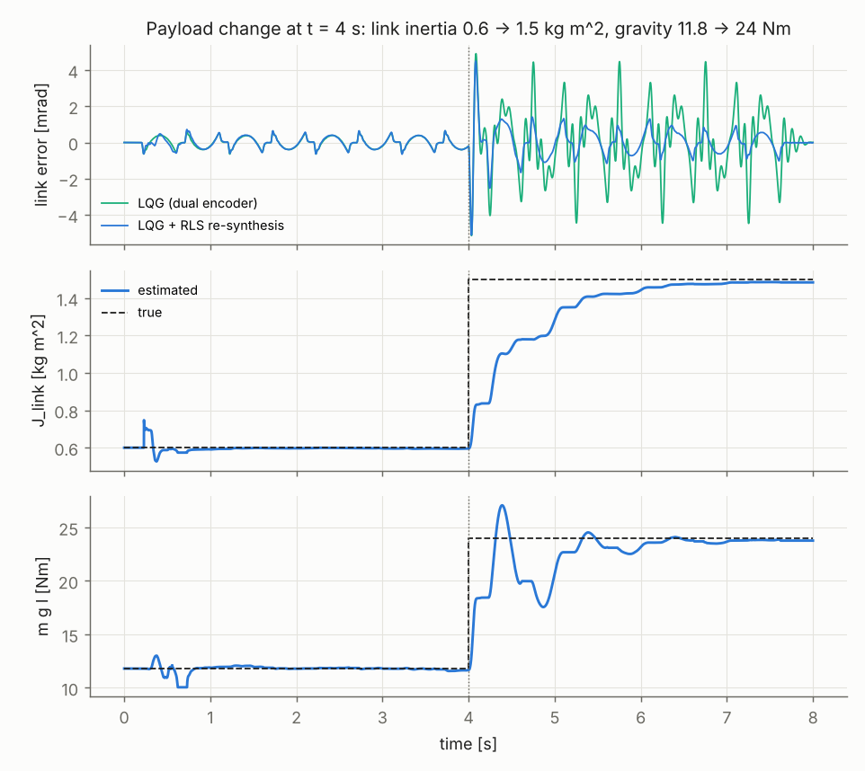

# Actuator Lab: From FOC to LQG on a Compliant Humanoid Joint

A C++ simulation testbench for one humanoid-class rotary joint (frameless PMSM, 50:1 compliant strain-wave gearbox, 0.6 kg m² link with gravity) and seven position controllers evaluated on it with identical metrics. The drive side runs a 20 kHz field-oriented current loop with SVPWM. On top of it sit cascade PID variants, a dual-encoder link loop with a notch, ADRC, super-twisting sliding mode, and a dual-encoder LQG with a load-torque Kalman state. Every controller is grid-tuned on the nominal plant with the same objective and then scored on a load step, measured loop margins, a 200-plant Monte Carlo, and a mid-run payload change.

The headline result is that the gearbox compliance, not the motor, decides what works. Motor-side controllers hold the rotor stiff and leave the link ringing on the gearbox spring at 13 Hz with a damping ratio near 0.02. The LQG is the only design that observes and damps that mode, and it cut peak deflection under a 25 Nm load step from 12.4 to 3.7 mrad and recovery from more than 600 ms to 33 ms.

Everything here is simulation. See [Limitations](#limitations) before reading the numbers as hardware performance.



## The plant

State $x = [i_d, i_q, \theta_m, \omega_m, \theta_l, \omega_l]$, integrated with RK4 at 40 kHz.

$$L\dot i_d = v_d - R i_d + \omega_e L i_q, \qquad L\dot i_q = v_q - R i_q - \omega_e L i_d - \omega_e \lambda, \qquad \omega_e = p\,\omega_m$$

$$J_m \dot\omega_m = K_t i_q - b_m\omega_m - \tau_{c,m}\tanh(\omega_m/\epsilon) - \tau_s/N$$

$$J_l \dot\omega_l = \tau_s - b_l\omega_l - \tau_{c,l}\tanh(\omega_l/\epsilon) - mgl\sin\theta_l + \tau_{ext}, \qquad \tau_s = k(\theta_m/N - \theta_l) + d(\omega_m/N - \omega_l)$$

| Parameter | Value | Parameter | Value |
|---|---|---|---|
| Pole pairs, $K_t$ | 14, 0.1 Nm/A | Gear ratio $N$ | 50 |
| $R$, $L$ | 0.15 Ω, 0.1 mH | Gearbox stiffness $k$ | 4000 Nm/rad (output) |
| Rotor inertia $J_m$ | 6e-5 kg m² | Gearbox damping $d$ | 2 Nm s/rad ($\zeta \approx 0.05$) |
| Bus, current limit | 48 V, 30 A (150 Nm output) | Link inertia $J_l$ | 0.6 kg m² |
| Motor encoder | 14 bit | Link encoder | 17 bit absolute |
| Current ADC | 12 bit over ±40 A, 0.05 A noise | Gravity $mgl$ | 11.8 Nm |

The reflected rotor inertia $N^2 J_m = 0.15$ kg m² is a quarter of the link inertia, which is typical of a heavy humanoid limb. That ratio puts the motor-side anti-resonance at $\sqrt{k/J_l}/2\pi = 13.0$ Hz and the resonance at $\sqrt{k(1/J_l + 1/N^2J_m)}/2\pi = 29.1$ Hz.

The controllers only see what a drive sees. Phase currents come through a noisy quantized ADC, angles come from quantized encoders, the inverter output is applied one PWM period late, and speed comes from a 400 Hz tracking observer. A finite difference of the 14-bit encoder at 20 kHz would have a 7.7 rad/s quantization floor.

## How to run

```bash
./scripts/run_all.sh            # build, 21 unit tests, identify, tune, evaluate, plot (~2 min, 2 cores)
docker build -t actuator-lab . && docker run --rm actuator-lab   # same build and tests in Ubuntu 24.04
./build/actlab_sim single:lqg --set lqg.w_ql=1e8                  # one run with a config override
```

The pipeline order matters and mirrors how this would be done on a bench.

1. `actlab_sim chirp_plant` adds a 2 to 600 Hz log chirp to the torque command under a soft position hold.
2. `scripts/identify.py` estimates the frequency response and fits a two-mass model. It writes `results/identified.txt`, which the C++ controllers read to place their notches.
3. `actlab_sim tune` grid-searches each controller family. The winners are frozen in `named_config()`.
4. `actlab_sim all` runs the tracking scenario, loop-gain measurements, a speed-loop sweep, the Monte Carlo and the payload test.
5. `scripts/analyze.py` writes the figures and `results/summary.md`.

## Results

### System identification



| Quantity | Identified | True (simulator) |
|---|---|---|
| Anti-resonance | 12.97 Hz | 12.99 Hz |
| Resonance | 28.64 Hz | 29.06 Hz |
| $J_m$ / $J_l$ (motor side) / $k$ | +6.6 % / +3.3 % / +2.9 % | |
| Gearbox damping | about 2x true | Coulomb friction is absorbed into the fitted viscous term |
| Loop delay | 853 µs | mostly the speed observer's phase lag |

The plain $H_1 = S_{uy}/S_{uu}$ estimate is biased in closed loop. Wherever encoder noise drives the controller harder than the chirp does, $H_1$ converges to $-1/C$ instead of the plant, and it showed up as a flat line at $1/K_p$ above 450 Hz. Using the injected chirp $r$ as an instrument, $H = S_{ry}/S_{ru}$, removes the bias.

### Nominal plant: 90° and -45° moves, then a 25 Nm load step

| Config | What it is | RMS err [mrad] | Load peak [mrad] | Recovery to 2 mrad | Chatter [Nm] |
|---|---|---|---|---|---|
| motor_only | P/PI cascade on the motor encoder | 5.18 | 10.3 | >600 ms | 0.031 |
| motor_defl | + gearbox deflection feedforward | 0.50 | 12.4 | >600 ms | 0.030 |
| motor_defl_velnotch | + notch in the speed loop (ablation) | 0.66 | 12.7 | >600 ms | 0.032 |
| motor_defl_dob | + disturbance observer (ablation) | 0.56 | 12.1 | >600 ms | 0.031 |
| dual_pi_notch | + link-encoder PI with notch at 13 Hz | 0.45 | 8.5 | 589 ms | 0.032 |
| adrc_dual | linear ADRC + link PI | 3.12 | 10.8 | 328 ms | 0.005 |
| stsmc_dual | super-twisting SMC + link PI | 1.56 | 12.0 | 182 ms | 0.016 |
| lqg | dual-encoder LQR + Kalman filter with load state | 0.43 | 3.7 | 33 ms | 0.032 |
| lqg_nodist | LQG without the load state (ablation) | 0.42 | 8.4 | >600 ms | 0.015 |

Chatter is the RMS sample-to-sample change of the motor torque command at 5 kHz.

### Measured loop margins

Each controller was run with a chirp injected at the motor torque input, and the loop gain $L = -S_{rc}/S_{ru}$ was measured from the controller's response $c$. Nothing here comes from a model.



| Config | Crossover | Phase margin | Gain margin | Peak sensitivity $M_s$ |
|---|---|---|---|---|
| motor_defl | 181 Hz | 21.6° | 7.1 dB | 3.6 |
| motor_defl_velnotch | 183 Hz | 34.1° | 7.0 dB | 2.7 |
| dual_pi_notch | 180 Hz | 17.3° | 3.5 dB | 4.0 |
| adrc_dual | 158 Hz | 3.3° | 1.3 dB | 19.3 |
| stsmc_dual | 252 Hz | 13.7° | 1.7 dB | 5.8 |
| lqg | 42 Hz | 71.9° | 7.1 dB | 1.8 |

The speed loop was designed for 40 Hz on the rigid inertia $J_m + J_l/N^2$, but it crosses over at 181 Hz. Above the resonance the motor only feels its own rotor, which is 5x lighter, so the loop gain is 5x higher than the design assumed. The sliding-mode and ADRC numbers are describing-function measurements of nonlinear loops and should be read as trends.

### Robustness over 200 randomized plants

Link inertia 0.5x to 3x (log-uniform), stiffness ±30 %, damping 0.5x to 2x, friction 0.5x to 2x, gravity 0.6x to 1.6x. Controllers keep the nominal model. Simulations run in parallel on a two-thread pool.



| Config | Well behaved | RMS median | RMS p90 | Load peak median | Recovered within 600 ms |
|---|---|---|---|---|---|
| motor_defl | 31 % | 2.8 mrad | 11.5 mrad | 13.2 mrad | 4.5 % |
| dual_pi_notch | 41.5 % | 28.8 mrad | 108 mrad | 186 mrad | 37.5 % |
| adrc_dual | 20 % | 27.9 mrad | 86 mrad | 65 mrad | 40.5 % |
| stsmc_dual | 34 % | 4.2 mrad | 24 mrad | 14.2 mrad | 60 % |
| lqg | 58 % | 1.6 mrad | 10.5 mrad | 4.1 mrad | 81 % |

"Well behaved" means below 2 mrad RMS with no sustained oscillation. No run went unstable in the sense of diverging, but the fixed-notch dual loop limit-cycled on many plants because the notch no longer sat on the mode. The five worst LQG runs all had link inertia near 2.8x nominal and reached 20 to 26 mrad RMS. LQG relies on its model, and that is where it pays for it.

### Notch placement and the link-side loop



Closing a PI loop on the link encoder is non-collocated, because the lightly damped 13 Hz locked-motor mode sits between the motor and the link. Without a notch only 4 of 30 gain combinations stayed under 1 mrad RMS. The rest went into a sustained oscillation of 5 to 90 mrad. With a notch at the identified anti-resonance all 30 stayed under 1 mrad.

### Payload change at t = 4 s (link inertia 0.6 to 1.5 kg m², gravity 11.8 to 24 Nm)



| Config | RMS 3 to 4 s (before) | RMS 6 to 8 s (after) |
|---|---|---|
| dual_pi_notch | 0.31 mrad | 255 mrad (limit cycle) |
| dual_rls (notch re-centred from RLS) | 86 mrad | diverged at 6.4 s |
| lqg | 0.29 mrad | 1.65 mrad |
| lqg_rls | 0.30 mrad | 0.48 mrad |

The heavier payload moves the locked-motor mode from 13 Hz to 8 Hz, outside the fixed notch. LQG with recursive least squares re-identifies inertia and gravity on a filtered rigid-body regressor and re-solves both Riccati equations when the inertia estimate moves by more than 5 %. The estimates stay within 5 % from 2.0 s after the change and end at 1.48 vs 1.5 kg m² and 23.8 vs 24 Nm. A full LQR plus Kalman re-synthesis takes about 150 µs.

An earlier version of this table showed lqg_rls at 0.24 and 0.44 mrad, better than plain LQG even before the payload changed, with the inertia estimate ending at 1.59. The code review found the cause. The state-variable filter's acceleration output was evaluated at the end of each sample and led the other regressors by about half a sample, which biased the inertia estimate 6 % high. Fixing it put the estimate within about 1 % of the truth and made the tracking slightly worse, so the earlier gain before the payload change came from the bias, not from learning. The numbers above are from the corrected filter.

### 1 kHz host loop timing

`rt_loop_bench` runs the position loop in a SCHED_FIFO host thread and an emulated drive (plant, FOC and speed loop) in a second thread that advances 1 ms of simulated time per 1 ms of wall time. State and commands cross through lock-free triple buffers, and the drive drops to a gravity-holding safe mode if three cycles pass without a fresh command.

| Condition | Wake latency p50 | p99 | p99.9 | Max | Late by > 1 ms |
|---|---|---|---|---|---|
| idle | 20 µs | 206 µs | 2.1 ms | 4.1 ms | 38 / 10,000 |
| 2 busy threads | 19 µs | 142 µs | 1.3 ms | 3.6 ms | 29 / 10,000 |

Controller compute time was 1.2 µs at p99. This is a stock virtualized kernel, and an earlier identical run had 5 late cycles instead of 38, so the tail is noise from the hypervisor rather than a property of the code. The watchdog tripped 1 to 2 times per 10 s run, which is the intended behavior on a kernel like this and the argument for PREEMPT_RT on real hardware.

## What worked

The dual-encoder LQG was the clear winner on load rejection, margins and the Monte Carlo. The 5-state Kalman filter estimates motor angle, motor speed, link angle, link speed and an unknown link-side load torque from the two encoders and the applied torque, with gravity fed through a known-input channel. Feeding the load estimate forward (extra torque $-\hat\tau_d$ and extra motor angle $-\hat\tau_d/k$) is responsible for most of the gain. Without it the same LQR recovers in more than 600 ms instead of 33 ms.

Solving the discrete Riccati equations with the structure-preserving doubling algorithm took 18 iterations. Plain Riccati iteration would need tens of thousands at 5 kHz because the closed-loop poles sit close to $z = 1$.

Model-based deflection feedforward alone cut nominal RMS error 10x (5.18 to 0.50 mrad) at no cost.

Identification from a closed-loop chirp recovered both modal frequencies to within 1.5 %, and the identified anti-resonance was what the notch needed.

## What did not work

A notch in the speed loop made tracking worse. The speed loop is collocated (motor torque in, motor speed out), so the resonance does not destabilize it. The loop actively damps the link through the motor. Notching that frequency removed the damping, and RMS error rose from 0.50 to 0.66 mrad. The notch belongs in the non-collocated link loop, which is where it was moved.

The disturbance observer did not help. With nominal inertia $J_m + J_l/N^2$ and a 15 Hz Q-filter the DOB treated the flexible mode as disturbance. Its result is kept as an ablation. The Kalman filter's load state is the version that works, because the observer model contains the spring.

The first tuning objective picked a ringing controller. RMS error plus peak deviation chose a link loop that oscillated for the whole load window. Adding the integrated absolute error over that window changed the winner (link $k_i$ went from 20 to 5 /s) and is the objective used for every number above.

The grid-searched cascade landed at 22° phase margin. A time-domain objective does not see robustness. The Monte Carlo shows the consequence. The right fix is a margin or $M_s$ constraint inside the tuner.

Adaptive cascade (RLS plus notch re-centring) failed before the payload even changed. The RLS regressor assumes a rigid joint. With the 13 Hz mode undamped, the estimates were biased, and moving the notch to follow them destabilized the link loop (86 mrad RMS before the payload change, divergence after it). The same RLS front end works inside the LQG because the LQG damps the mode first. Also, viscous and Coulomb friction regressors are nearly collinear on back-and-forth moves, since $\tanh(v/\epsilon)$ and $v$ always share a sign, so only inertia and gravity estimates are applied.

A speed clamp at 350 rad/s broke the nominal test. The 90° move needs 368 rad/s at the motor. The clamp now sits at 420 rad/s, just above the back-EMF limit, where it still stops saturated position loops from asking for impossible speeds.

The first energy-conservation test failed for the wrong reason. Released with 2 A in the q axis and zero resistance, the rotor spun to 2200 rad/s, where $\omega_e h \approx 0.8$ and RK4 is no longer convergent. With a realistic release the drift is 4.7e-9 per second at the production step and falls 32x per halving of $h$, which is the expected fifth-order rate.

## Tools and techniques applied

On the control and estimation side the project uses FOC (Clarke and Park transforms, SVPWM, dq decoupling), cascade PI with back-calculation anti-windup, feedforward, gearbox deflection compensation, Tustin-prewarped notch and low-pass biquads, a disturbance observer, discrete LQR on an augmented state with integral action, a steady-state Kalman filter with an augmented disturbance state (LQG), linear ADRC with a 3rd-order extended state observer, super-twisting sliding mode, RLS with forgetting and covariance capping, state-variable filters for regressors, and gain scheduling by online re-synthesis.

The analysis side uses log-chirp frequency-response identification with an instrumental-variable estimator, coherence, nonlinear least-squares model fitting, measured loop gain with phase margin, gain margin and peak sensitivity, Monte Carlo over plant parameters, ablations, and grid-search tuning against a fixed objective.

The software side covers the RoboJackets software-training topics and goes past them. It is C++ with templates (`Biquad<T>`, `RLS<N>`, `SpscQueue<T, N>`), RAII (`CsvTelemetry` owns its thread and file handle), smart pointers behind an abstract controller interface and factory, a telemetry class that deletes its copy and move operations because its worker thread captures `this`, `std::thread`, `std::atomic` with acquire and release ordering, a lock-free SPSC queue and triple buffer, a thread pool on an atomic work counter, SCHED_FIFO with `mlockall`, Eigen, and CMake with sanitizer options. It is tested with 23 GoogleTest cases under AddressSanitizer, UBSan and ThreadSanitizer, built in Docker on Ubuntu 24.04, wired for GitHub Actions, and versioned in Git. Analysis is Python with NumPy, SciPy, pandas and Matplotlib.

## Topics from the list used here

- Classical control (1A): PI and PD loops, cascade control (current, speed, position), feedforward, anti-windup and saturation handling, gain scheduling, Bode plots, gain and phase margin, frequency-response identification, sensitivity (peak $M_s$), disturbance rejection and tracking, resonance and notch filters, sampled-data effects, discrete-time design with Tustin prewarping.
- Linear systems and modern control (1B): state-space modeling, continuous- and discrete-time systems, state observers, multivariable (dual-encoder) feedback.
- Optimal control (1C): discrete-time and infinite-horizon LQR, the algebraic Riccati equation, LQG and the separation principle.
- Nonlinear control (1E): sliding-mode control and higher-order (super-twisting) sliding mode.
- Robust control (1F): model uncertainty, disturbance modeling, disturbance observers and extended-state observers, Monte Carlo robustness over 200 randomized plants.
- Adaptive control (1G): recursive least squares with a forgetting factor, online parameter estimation, indirect adaptive control by online LQG re-synthesis.
- Stochastic estimation (1H, 3B): noise models, a Kalman filter with an augmented disturbance state, Monte Carlo methods.
- Other paradigms (1I): ADRC and disturbance-rejection control.
- Robot dynamics (2A, 2C): RK4 and numerical stability, motor and actuator dynamics, gearboxes and reflected inertia, Coulomb and viscous friction, identification of physical parameters.
- Sensor modeling (3A): noise, quantization and latency in the current ADC and both encoders.
- Embedded and real-time (9B, 9C): fixed-rate and multirate loops (20 kHz current, 1 kHz host), jitter measurement, deadline monitoring, a watchdog with a fail-safe state, lock-free communication between control and I/O threads, PMSM, FOC, Clarke and Park transforms, space-vector PWM, encoder feedback, current limiting.
- Mechanical (10): transmission elasticity, mechanical compliance and structural resonance.
- Software engineering (8): C++, Python, Bash, Git, CMake, Ubuntu, AddressSanitizer, UBSan, ThreadSanitizer, GoogleTest, CI, Docker, NumPy, SciPy, pandas, Matplotlib, seed management, statistical comparison of controllers, automated report generation, interfaces and a factory, producer-consumer threads, lock-free data structures, RAII, configuration-driven experiments, a thread pool, real-time scheduling.
- System identification (14): first-principles modeling, grey-box identification, chirp frequency-response testing, least squares, Monte Carlo simulation, ablation studies, benchmarking against baselines.
- RoboJackets software training slides: Ubuntu, Docker, Git, `const` and `constexpr`, templates, namespaces, classes and headers, RAII, smart pointers, deleted copy and move operations on a type whose worker thread captures `this`, `std::thread` and `join`, atomics, race conditions checked with ThreadSanitizer.

## What I learned

Collocation decides where a notch belongs. A resonance in a collocated loop is a source of damping that a notch throws away. A resonance between the actuator and the sensor is a stability limit that a notch can push back, until the payload moves it.

The tuning objective is the specification. Twice the optimizer gave me exactly what I asked for and not what I wanted, once a ringing controller and once a 22° phase margin.

An adaptive law is only as good as its regressor's model. RLS on a rigid-body regressor needed the flexible mode damped before its estimates meant anything.

Closed-loop identification has a trap. The textbook FRF estimate quietly measures the controller wherever the excitation is weak, and the coherence plot is what gives it away.

## Limitations

The inverter is an average model with no switching ripple or dead time. There is no thermal model, no cogging torque and no backlash. Gearbox stiffness is linear, while real strain-wave gears stiffen with load and have hysteresis. Timing results come from a virtualized non-RT kernel. The obvious next steps are a margin constraint in the tuner, an $H_\infty$ or $\mu$ design for the inertia range the Monte Carlo exposed, and running the same code on an STM32 against a real joint.

## Resume entry

**Actuator Lab: Compliant Humanoid Joint Control** | C++, Eigen, Python, GoogleTest, Docker

- Cut peak link deflection under a 25 Nm load step from 12.4 to 3.7 mrad and recovery from over 600 ms to 33 ms on a simulated 50:1 compliant humanoid joint by designing a dual-encoder LQG in C++ with a Kalman load-torque state, scored against cascade PID, ADRC and super-twisting SMC on 200 randomized plants.
- Identified the gearbox anti-resonance and resonance within 0.2 % and 1.5 % from a closed-loop log chirp using an instrumental-variable FRF and a two-mass fit, then showed that a notch at that frequency made 30 of 30 link-loop gain settings usable (4 of 30 without it) but limit-cycled after a payload change, which LQG with online RLS re-synthesis held to 0.48 mrad RMS.
- Built the 20 kHz FOC current loop (SVPWM, decoupling, anti-windup) and a 1 kHz SCHED_FIFO host and drive harness with lock-free triple buffers and a watchdog, verified by 23 GoogleTest cases under ASan, UBSan and ThreadSanitizer in Docker and CI.

## Repository layout

```
include/actlab/   plant, FOC, filters, RLS, controllers, LQG, drive, concurrency, telemetry
src/              implementations and experiment definitions
apps/             actlab_sim (offline experiments), rt_loop_bench (threaded 1 kHz harness)
tests/            GoogleTest suites
scripts/          run_all.sh, identify.py, analyze.py
results/          figures, metrics CSVs, summary.md (raw high-rate logs are regenerated, not committed)
```
# Actuator-Lab

# ActuatorLab

# ActuatorLab

